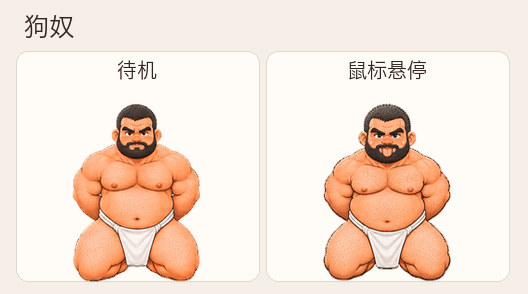

# Hammock Bear 🐻 · 狗奴

**Big beard. Hairy chest. One very lucky hammock.** Meet Gou Nu, a burly ChatGPT desktop pet for gay guys who have a soft spot for bears. He rocks in his chain hammock while you work. Hover over him and see how well he handles a little attention.

**大胡子、厚胸毛，还有一张专属链条吊床。** 如果你就吃熊系这款，来认识一下「狗奴」。你工作时他在吊床上晃，鼠标一停在他身上，他就伸舌头、喘口气，汗珠顺着胸口往下滑。



**[Watch all 9 animations · 看完整动作演示](all-actions.mp4)** · **[Install on desktop · 安装到桌面](#install--安装)** · **[Download the V2 sprite sheet · 下载精灵图](https://raw.githubusercontent.com/roarstarxu-art/Hammock-Bear-ChatGPT-Desktop-Pet/main/spritesheet.png)**

Working, waving, or crawling across the screen in a white fundoshi, he gives you plenty of reasons to look away from your to-do list. The V2 sheet includes **9 animation states and 16 gaze directions**.

他会坐吊床、挥手打招呼，还会穿着白色日式传统褌低伏爬过屏幕。V2 精灵图包含 **9 个动作状态和 16 个视线方向**。

## Install · 安装

1. Use the ChatGPT desktop app with support for V2 pet install links. 请使用支持 V2 宠物安装链接的 ChatGPT 桌面端。
2. Copy the whole line below into your browser’s address bar. Allow it to open the desktop app and confirm the installation. 复制下方整行到浏览器地址栏，允许打开桌面应用并确认安装。
3. Select **Hammock Bear** under **Settings → Pets**, then type `/pet` to show him. 在 **设置 → 宠物**里选中 **Hammock Bear**，输入 `/pet` 显示宠物。

```text
codex://pets/install?name=Hammock%20Bear&imageUrl=https%3A%2F%2Fraw.githubusercontent.com%2Froarstarxu-art%2FHammock-Bear-ChatGPT-Desktop-Pet%2Fmain%2Fspritesheet.png&spriteVersionNumber=2
```

[ChatGPT desktop pet guide · 桌面宠物说明](https://learn.chatgpt.com/docs/pets) · [V2 install link reference · 安装链接说明](https://learn.chatgpt.com/docs/app/commands#pets)

If he’s your type, give him a ⭐ or send the preview to a friend who loves bears. 喜欢这一款，可以点颗 ⭐，也可以把动图转给同样喜欢熊系的朋友。
